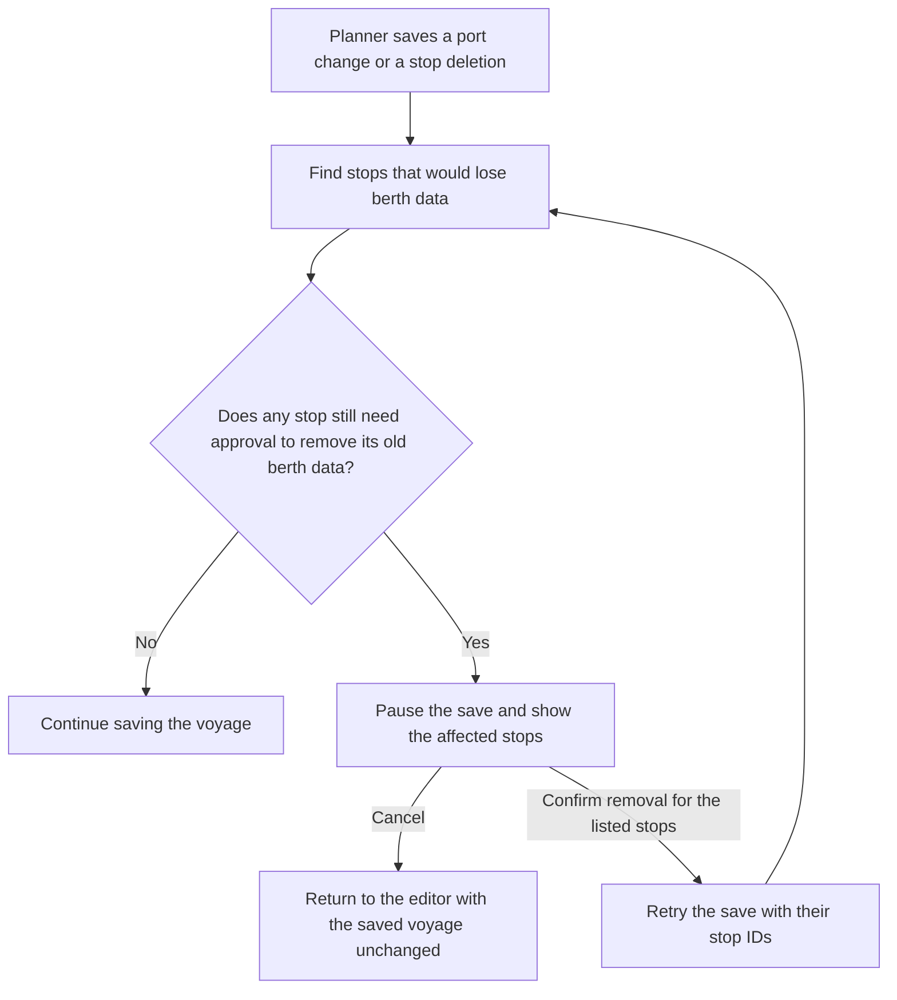

# Why removing berth data needs confirmation

A stop can have a berth assignment, a request date or notes from the port. If stop 42 moves from Cologne to Bonn, its berth in Cologne cannot move with it because its another physical location in another port. Confirming removal for stop 42 means “remove this stop’s old berth data.” becuase the planning of the voyage changed (this can happen multiple times while planning cruises). A berth in Bonn still needs to be arranged separately.

When a port changes or a stop is deleted, Hafenmeister finds the stops that would lose berth data. An empty berth record needs no confirmation. The editor lists the affected stops together. The planner can confirm the whole list in one step, and the backend checks approval for each stop ID.

In the [example](../example.mjs), stops 42 and 57 would both lose berth data.

- **Yes** means a confirmation is missing. If the request contains only ID 42, the save pauses because 57 still needs approval. The editor shows both stops.
- **No** means no confirmation is missing. If you confirm removal for both 42 and 57, the save can continue. The same applies if no stop would lose berth data.
